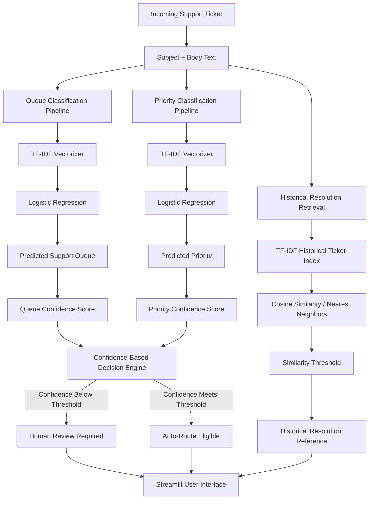

# AI IT Help Desk Copilot — System Architecture

## Architecture Overview

The AI IT Help Desk Copilot combines machine-learning classification, confidence-based human review, historical ticket retrieval, and an interactive Streamlit interface.

## Core Components

### 1. Ticket Input

The system receives natural-language support requests containing the user's issue.

The current model uses:

- ticket subject
- ticket body

These are combined into one text field before analysis.

### 2. Queue Classification

The queue classification pipeline predicts which support team should receive the ticket.

Current model:

**TF-IDF + Logistic Regression**

The classifier returns:

- recommended support queue
- prediction confidence
- top three routing suggestions

### 3. Priority Classification

A separate machine-learning model predicts whether a ticket should be:

- High
- Medium
- Low

The current implementation also uses:

**TF-IDF + Logistic Regression**

### 4. Human-in-the-Loop Decision Engine

The system applies confidence thresholds before allowing automated routing.

Current prototype thresholds:

- Queue confidence: **35%**
- Priority confidence: **45%**

If either score falls below its threshold, the system returns:

**HUMAN REVIEW REQUIRED**

This prevents the Copilot from treating uncertain predictions as reliable decisions.

### 5. Historical Resolution Retrieval

The retrieval engine searches previously resolved tickets for similar cases.

Technology used:

- TF-IDF
- Cosine similarity
- Nearest Neighbors

Current prototype minimum similarity threshold:

**23%**

Cases below the threshold are excluded.

Historical solutions are displayed only as references and require technician review.

### 6. Streamlit Interface

The Streamlit application provides the user-facing interface.

It displays:

- recommended queue
- queue confidence
- predicted priority
- priority confidence
- human-review status
- top routing alternatives
- similar historical cases
- reference resolutions

## Design Principle

The project follows a **human-in-the-loop AI** design.

The system assists technicians with repetitive triage and information retrieval while keeping final judgment with support personnel whenever model confidence is low.